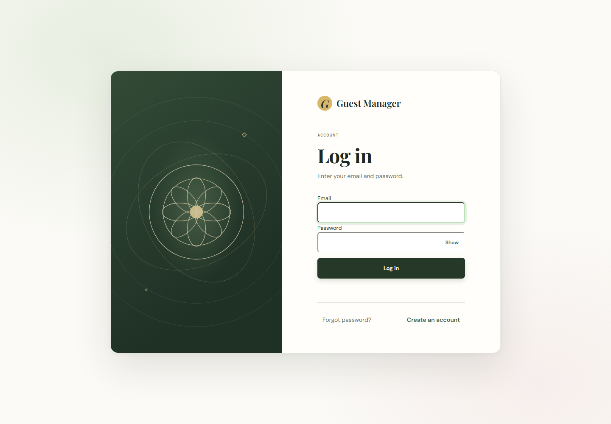
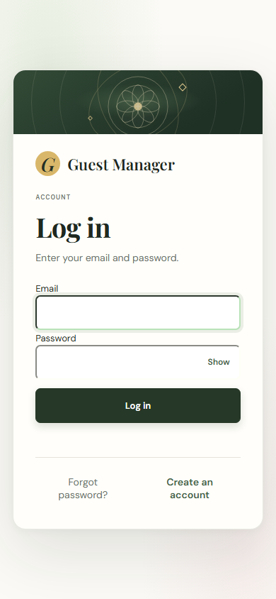
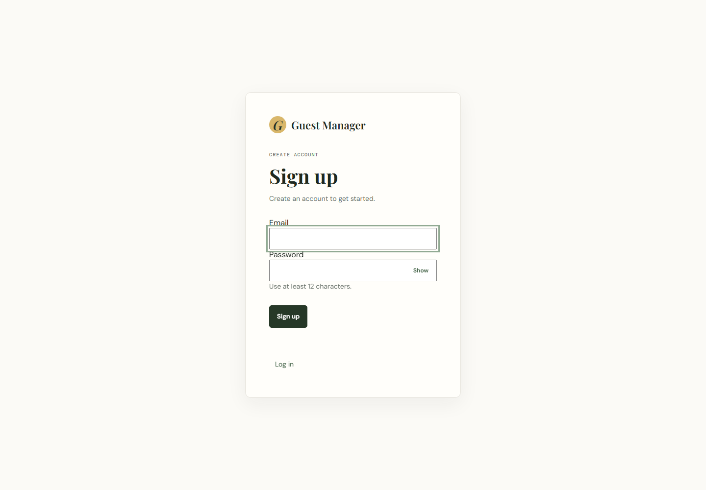
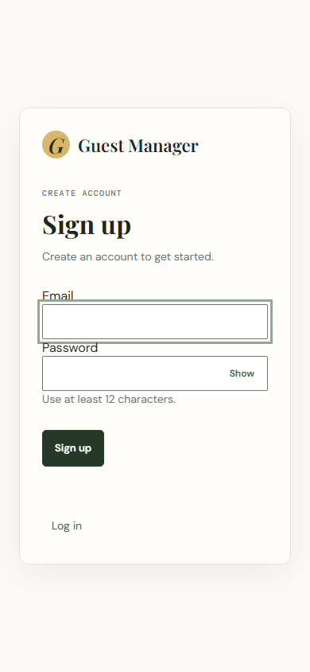
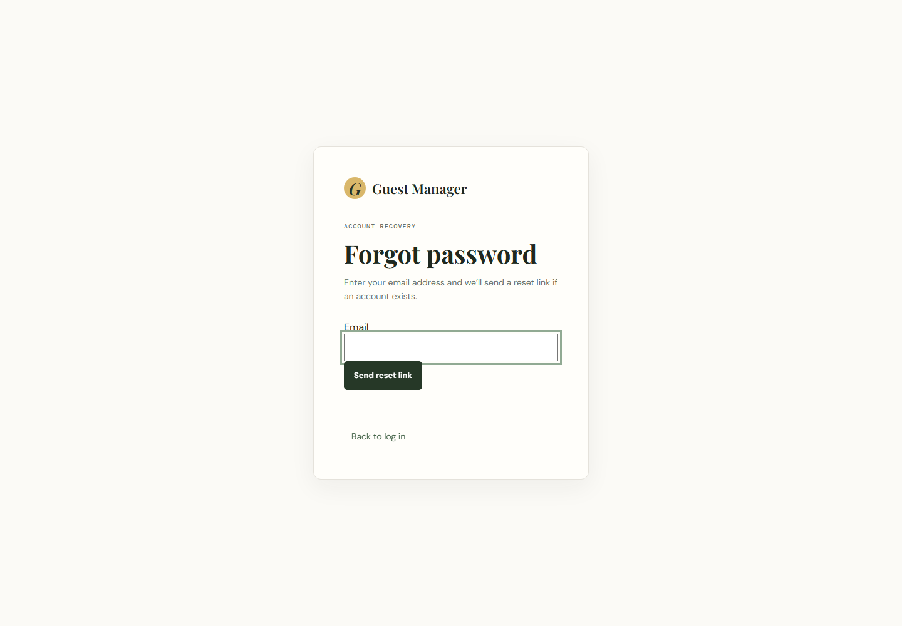
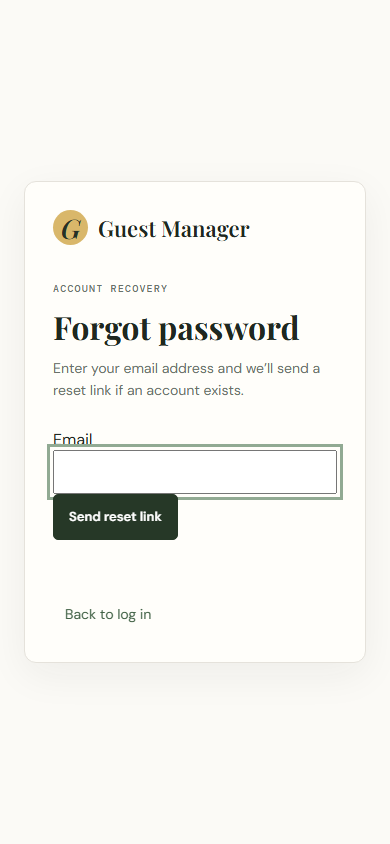
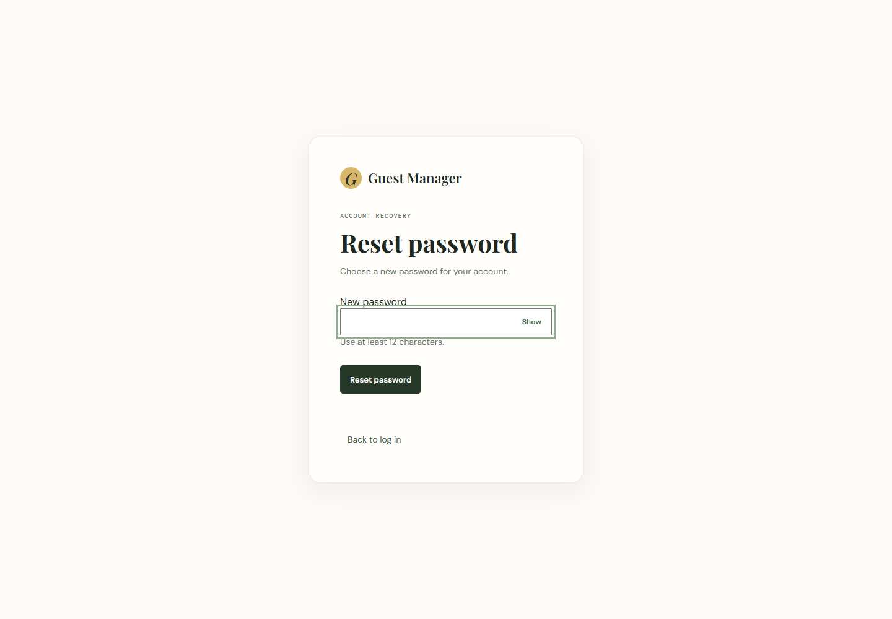
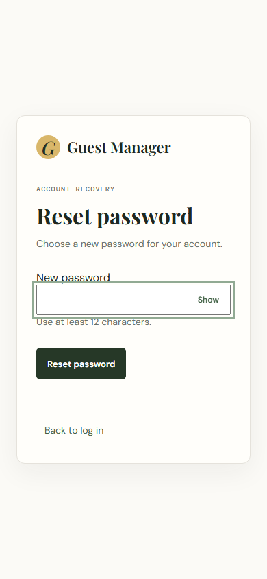
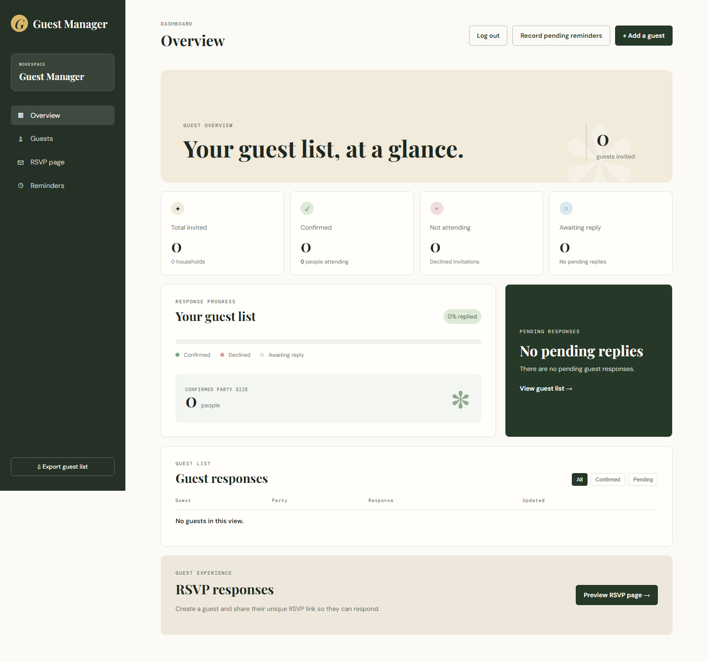
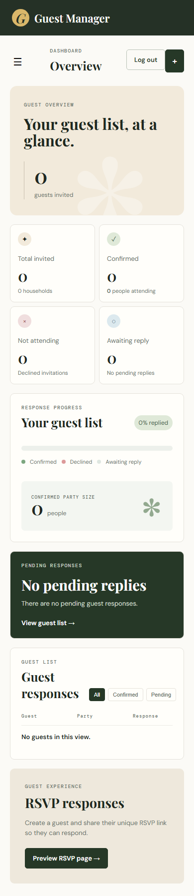

# Guest Manager

A responsive guest-management website with secure account authentication and invitation responses.

**Live demo:** [Replace with your Render URL](https://your-render-service.onrender.com)

## Features

- Email and password sign-up, login, and logout.
- Bcrypt password hashing and secure, HTTP-only session cookies.
- Password reset email links with single-use, 15-minute tokens.
- Login, sign-up, and password-reset rate limits.
- Account-protected guest dashboard and account-scoped guest records.
- Guest invitations with public RSVP links.
- Responsive layouts for desktop and mobile.
- PostgreSQL on Render; SQLite for local development.

## Screenshots

The Playwright screenshot script generates full-page desktop (1440 px) and mobile (390 px) captures. Images are refreshed by running `npm run screenshots` or manually starting the **Refresh UI screenshots** GitHub Actions workflow.

For the workflow to commit refreshed images, enable **Settings → Actions → General → Workflow permissions → Read and write permissions**. Repository branch protection must also permit the workflow to push to the default branch.

| Page | Desktop | Mobile |
| --- | --- | --- |
| Login | [](docs/screenshots/login-desktop.png) | [](docs/screenshots/login-mobile.png) |
| Sign up | [](docs/screenshots/signup-desktop.png) | [](docs/screenshots/signup-mobile.png) |
| Forgot password | [](docs/screenshots/forgot-password-desktop.png) | [](docs/screenshots/forgot-password-mobile.png) |
| Reset password | [](docs/screenshots/reset-password-desktop.png) | [](docs/screenshots/reset-password-mobile.png) |
| Dashboard | [](docs/screenshots/dashboard-desktop.png) | [](docs/screenshots/dashboard-mobile.png) |

## Tech stack

- **Application:** Python, Flask, SQLAlchemy, Flask-Limiter, Flask-Cors
- **Database:** SQLite locally; PostgreSQL in production
- **Authentication:** bcrypt password hashes and secure Flask session cookies
- **Frontend:** Existing responsive HTML, CSS, and JavaScript
- **Email:** SMTP
- **Screenshot tooling:** Node.js, npm, and Playwright
- **Hosting:** Render Blueprint

This repository is a Flask application, not a Node/Express, React/Vite, or MongoDB application. The website and its API are served together by Flask so secure session cookies work same-origin. A Render-managed PostgreSQL database is configured by the Blueprint; a MongoDB Atlas URI is not used by this SQLAlchemy application.

## Local setup

Requirements: Python 3.10 or later, Node.js 20 or later, and npm.

From the project directory, create a Python environment, install dependencies, and copy the environment template:

```powershell
py -3 -m venv .venv
.\.venv\Scripts\Activate.ps1
python -m pip install -r requirements.txt
Copy-Item .env.example .env
```

Generate a signing secret and put the value in `.env` as `APP_SECRET`:

```powershell
python -c "import secrets; print(secrets.token_urlsafe(48))"
```

Start the website:

```powershell
python app.py
```

Open <http://127.0.0.1:8000>. New visitors are directed to the login page; create an account using **Create an account**.

### Environment variables

| Variable | Description |
| --- | --- |
| `APP_ENV` | Set to `production` when deployed. |
| `PORT` | HTTP port. Render sets this automatically. |
| `APP_SECRET` | Random session-signing secret. Required in production. |
| `DATABASE_URL` | SQLAlchemy URL. Defaults to local SQLite; Render supplies PostgreSQL. |
| `CLIENT_URL` | Public site origin. Used to create password-reset links and as the only allowed CORS origin. Render’s hostname is detected automatically when this value is omitted. |
| `PUBLIC_BASE_URL` | Local development origin fallback. `CLIENT_URL` takes precedence. |
| `COOKIE_SECURE` | Set to `true` for HTTPS. Enabled automatically in production. |
| `RATELIMIT_STORAGE_URI` | Flask-Limiter backend. `memory://` is appropriate for local use and the single-worker deployment; use shared Redis when scaling. |
| `SMTP_HOST`, `SMTP_PORT` | SMTP server hostname and port. |
| `SMTP_USERNAME`, `SMTP_PASSWORD` | SMTP credentials. Never commit these values. |
| `SMTP_FROM_EMAIL` | Sender address authorized by your email provider. |
| `SMTP_USE_TLS`, `SMTP_USE_SSL` | Configure STARTTLS or implicit TLS. Do not enable both. |

To test password recovery locally, configure an SMTP sandbox such as Mailtrap in `.env`, create an account using an address routed to that sandbox, and use **Forgot password?**. Reset links expire after 15 minutes and can be used once. Without SMTP configuration, reset requests for existing accounts return an email-delivery error.

### Generate screenshots locally

Install the JavaScript screenshot dependency and the Playwright Chromium browser once:

```powershell
npm install
npx playwright install chromium
npm run screenshots
```

The script launches a temporary local Flask server with an isolated temporary database, captures five pages at both viewport sizes, and removes the temporary database when finished. Its dashboard image is produced by signing up and logging in as a temporary test account; no sample guests or demo data are added to the application or its persistent database.

## Deployment on Render

### Create the service and database

1. Push the project to the `main` branch of the connected GitHub repository.
2. Sign in to Render and choose **New → Blueprint**.
3. Connect GitHub, select `harshitjain5580-ai/guest-management-`, and deploy the Blueprint from `main`.
4. Review the resources from the root `render.yaml`. The Blueprint creates a Flask web service and a PostgreSQL database, and connects them using `DATABASE_URL`. Check the database plan, backups, and retention in your Render account before storing production data.
5. If Render prompts for the `sync: false` variables, set `CLIENT_URL` to the public `https://…onrender.com` address of this web service. If the assigned hostname is not available during the initial prompt, leave it unset; the app detects Render’s hostname. You can later set a custom-domain URL in **Web Service → Environment**.
6. Configure `SMTP_HOST`, `SMTP_PORT`, `SMTP_USERNAME`, `SMTP_PASSWORD`, and `SMTP_FROM_EMAIL` using credentials from your SMTP provider. Use the provider’s required TLS mode. Password-reset emails will fail until SMTP is configured.
7. Keep Render’s generated `APP_SECRET`. Set a shared `RATELIMIT_STORAGE_URI` if you later scale to multiple workers or instances.
8. Wait for the deployment to finish and check `https://<your-service>.onrender.com/api/health`. A healthy response is `{"status":"ok"}`. Verify sign-up, login, logout, and a password-reset email before inviting users.
9. Replace the live-demo URL at the top of this README with the service’s final public URL.

The Blueprint is configured to auto-deploy commits pushed to `main`. Review the service’s Render **Settings → Auto-Deploy** after deployment.

### Database choice and network access

The current application uses SQLAlchemy and PostgreSQL; its Render Blueprint already provisions and securely connects that database. **Do not create a MongoDB Atlas cluster for this code:** `MONGO_URI` and MongoDB Atlas IP access lists are not read by the application. In particular, do not open a database to `0.0.0.0/0`; that allows connections from any IP address. If you later migrate the application to MongoDB, choose a supported driver and database schema first, and allow only the required network access.

## Folder structure

```text
client/                   Existing website pages and browser assets
server/
  controllers/            Authentication logic
  middleware/             Session-protected routes
  routes/                 Authentication and dashboard endpoints
  services/               SMTP email and reminder processing
  config.py               Environment and database configuration
  database.py             SQLAlchemy connection and initialization
  models.py               User, reset-token, and guest tables
docs/screenshots/          Generated desktop and mobile screenshots
scripts/screenshots.js    Local Playwright screenshot runner
tests/                    Authentication and database tests
.github/workflows/        Manual screenshot refresh workflow
app.py                    Flask application entry point
render.yaml               Render web service and PostgreSQL Blueprint
```
